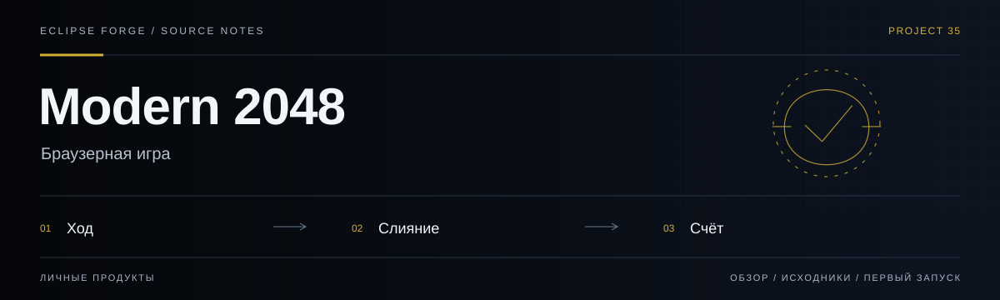
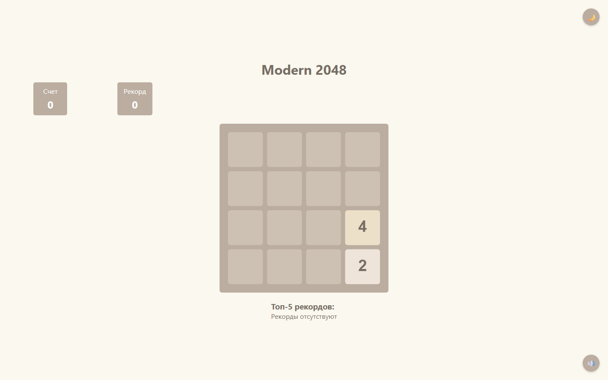
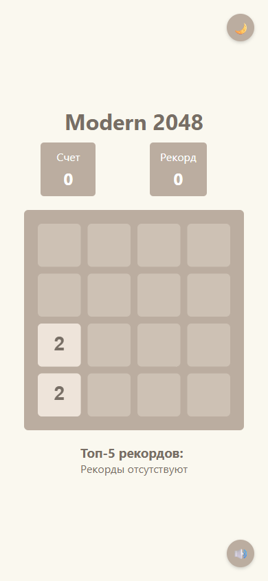

# Modern 2048

<!-- project-links:start -->
[Открыть веб-версию](https://pavelhopson.github.io/modern-2048/) · [Документация](docs/repository-guide.md) · [Код](https://github.com/PavelHopson/modern-2048/tree/main) · [История изменений](https://github.com/PavelHopson/modern-2048/commits/main/)
<!-- project-links:end -->



**Браузерная игра.** Современная веб-реализация 2048 как самостоятельная игра и пример интерактивного интерфейса.

<!-- eclipse-forge-projects:start -->
## Проекты Eclipse Forge

[Главная Eclipse Forge](https://eclipse-forge.ru/) · [Eclipse Library](https://library.eclipse-forge.ru/) · [Eclipse DnD Forge](https://dnd.eclipse-forge.ru/)

Исходный код: [Eclipse Forge Landing](https://github.com/PavelHopson/Eclipse-forge-website) · [Eclipse Chat](https://github.com/PavelHopson/eclipse-chat) · [Eclipse Connect](https://github.com/PavelHopson/eclipse-connect) · [Eclipse Library](https://github.com/PavelHopson/eclipse-library) · [Eclipse AI Hub](https://github.com/PavelHopson/eclipse-ai-hub) · [Eclipse Ultron / Sentinel](https://github.com/PavelHopson/eclipse-hopson-sentinel) · [Eclipse Webclaw](https://github.com/PavelHopson/Eclipse-webclaw) · [Eclipse DnD Forge](https://github.com/PavelHopson/eclipse-dnd-forge) · [Finflow](https://github.com/PavelHopson/finflow) · [Eclipse Media](https://github.com/PavelHopson/eclipse-media) · [Shotforge](https://github.com/PavelHopson/shotforge) · [Text2Image](https://github.com/PavelHopson/Text2Image) · [Educator AI](https://github.com/PavelHopson/Educator-AI) · [@pavelhopson/retry-http](https://github.com/PavelHopson/retry-http)
<!-- eclipse-forge-projects:end -->

<!-- repository-guide:start -->
[Интерфейс](#readme-interface) · [Первый запуск](#readme-start) · [Что внутри](#readme-map) · [Путеводитель](docs/repository-guide.md#start) · [Карта кода](docs/repository-guide.md#map) · [Проверки](docs/repository-guide.md#checks) · [Границы и права](docs/repository-guide.md#boundaries)

<a id="readme-interface"></a>

## Интерфейс



**Новое игровое поле Modern 2048: плитки, счёт и локальные рекорды.**

Локальный снимок от 8 сентября 2026: отдельный профиль браузера, без внешних API и пользовательских секретов. Это вид интерфейса, не подтверждение production-функций.

<details>
<summary><strong>Мобильный экран · 390 px</strong></summary>



</details>

[Открыть в полном размере](docs/assets/ui/overview.png) · [Данные снимка](docs/assets/ui/capture.json)

<a id="readme-map"></a>

## Проект за минуту

- **[Игра](<src/js/main.js>)** — Инициализация игрового интерфейса.
- **[Управление](<src/js/InputHandler.js>)** — Обработка пользовательского ввода.
- **[Плитки](<src/js/Tile.js>)** — Поведение элементов игрового поля.

<a id="readme-start"></a>

## Начать локально

**Среда:** Node.js и npm. **Источник:** [package.json](<package.json>).

Из корня клонированного репозитория:

```bash
npm ci
npm run dev
```

Запуск сервера разработки не выполняет публикацию. Проверьте настройки окружения и основной пользовательский сценарий перед выпуском.

<details>
<summary><strong>Перед первым запуском и изменением кода</strong></summary>

- Команды сверены с исходниками 8 сентября 2026. Это инструкция, а не отметка об успешном запуске или текущем production.
- Установка зависимостей может обращаться в registry и выполнять lifecycle scripts. Используйте отдельную рабочую среду и демонстрационные данные.
- Проверяйте клавиатуру, touch и сохранение прогресса; оформление README не заменяет игровой тест.


</details>
<!-- repository-guide:end -->

## Возможности

- Классический геймплей -- точное соблюдение правил оригинальной игры 2048
- Плавные анимации -- движение, слияние и появление плиток
- Светлая и темная темы с сохранением выбора
- Полная адаптивность -- десктоп, планшет, телефон
- Сенсорное управление свайпами для мобильных устройств
- Таблица рекордов (топ-5) с сохранением в localStorage
- Управление с клавиатуры (стрелки + WASD)
- Звуковые эффекты
- Доступность -- навигация с клавиатуры и скринридеры

---

## Технологический стек

| Технология | Назначение |
|---|---|
| **JavaScript (ES6+)** | Игровая логика, анимации |
| **HTML5 Canvas** | Рендеринг игрового поля |
| **SASS** | Стилизация и темы |
| **Vite** | Сборка и dev-сервер |
| **ESLint + Prettier** | Качество и форматирование кода |
| **GitHub Pages** | Хостинг |

---

## Быстрый старт

```bash
git clone https://github.com/PavelHopson/modern-2048.git
cd modern-2048
npm install
npm run dev
```

Откройте http://localhost:5173

### Доступные команды

| Команда | Описание |
|---|---|
| `npm run dev` | Запуск сервера разработки |
| `npm run build` | Сборка для production |
| `npm run preview` | Предпросмотр собранного проекта |
| `npm run lint` | Запуск линтера |
| `npm run lint:fix` | Автоисправление линтера |
| `npm run format` | Форматирование кода (Prettier) |
| `npm run deploy` | Деплой на GitHub Pages |

---

## Структура проекта

```
modern-2048/
├── src/
│   ├── js/
│   │   ├── core/          # Game.js, Tile.js, Grid.js
│   │   ├── animation/     # Система анимаций
│   │   ├── input/         # Keyboard + Touch обработчики
│   │   ├── ui/            # ThemeManager, ScoreManager
│   │   └── main.js        # Точка входа
│   └── styles/            # SASS (main, variables, themes)
├── public/sounds/         # Звуковые эффекты
├── vite.config.js
├── eslint.config.js
├── package.json
└── LICENSE
```

---

## Лицензия

Проект распространяется под лицензией MIT. Подробнее см. [LICENSE](LICENSE).

## Автор

**Павел Хопсон** — [GitHub](https://github.com/PavelHopson)
